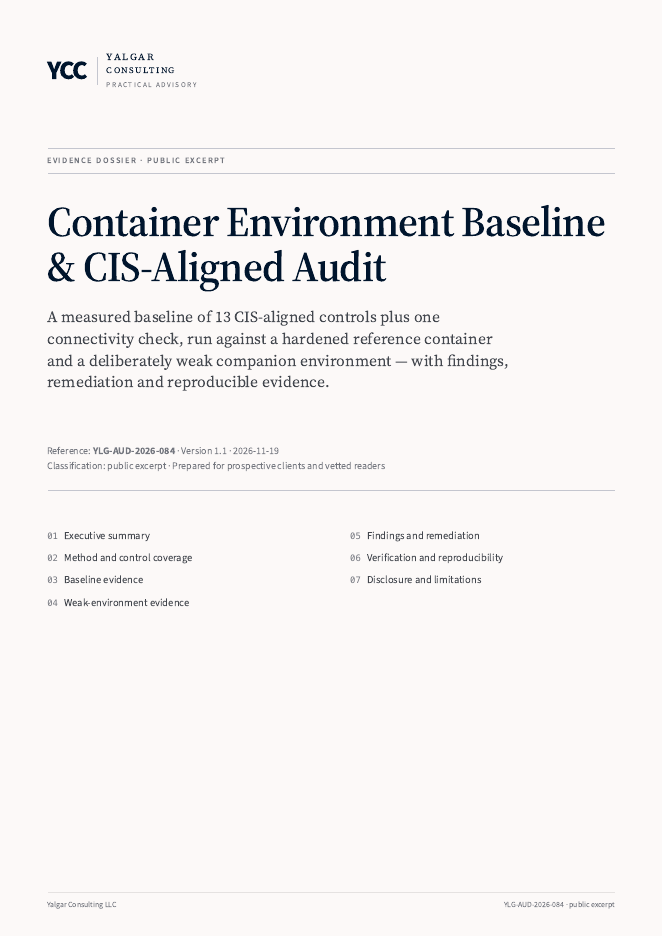
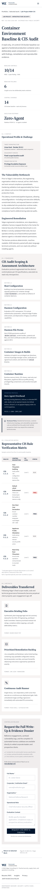

# CIS Docker Baseline Audit — evidence-backed case study

[](https://github.com/pmyash911/cis-docker-baseline-case-study/actions/workflows/ci.yml)

A read-only audit harness with 13 CIS-aligned controls plus a separate connectivity
check, run against a hardened reference container and a deliberately weak companion
environment — with raw JSON evidence, a dossier, and a reproducible verification path.


## Quickstart

Requires Node 22. The full audit run also needs a Linux host with Docker; on other
hosts the host-level controls report `N/A` or `WARN` rather than a false pass.

```bash
npm ci
npm run build                   # required before the tests: the suite starts `next start`
node --test tests/*.test.mjs    # 13 tests
sh lab/cis-audit/audit.sh --json
```

The harness is read-only: it inspects daemon configuration, file permissions, auditd
rules and the runtime flags of running containers. It installs nothing and changes
nothing. Exit codes are `0` (no failures), `1` (a check failed, connectivity included)
and `2` (usage error); `--no-fail-exit` is available for demos.

Sample `--json` output (abridged; one check per status shown):

```json
{
  "tool": "ycc-cis-audit",
  "version": "2.0.0",
  "framework": "CIS-aligned",
  "connectivity": {
    "id": "HOST 000",
    "title": "Docker daemon reachable",
    "status": "PASS",
    "evidence": "server 29.9.3 on Linux/6.12.114"
  },
  "summary": { "pass": 9, "fail": 1, "warn": 0, "na": 3, "total": 13 },
  "checks": [
    { "id": "AUD-01", "title": "Host filesystem auditing (auditd)", "area": "Host", "status": "N/A", "evidence": "auditd is not installed" },
    { "id": "AUD-04", "title": "Default ulimit enforcement", "area": "Daemon", "status": "FAIL", "evidence": "default-ulimits is missing from daemon config" },
    { "id": "AUD-10", "title": "Read-only root filesystem", "area": "Runtime", "status": "PASS", "evidence": "all containers use a read-only root filesystem" }
  ]
}
```

`summary` counts the 13 CIS-aligned controls only. `connectivity` is the separate
daemon-reachability check and is never one of the 13.

## Results

Every count below comes from the recorded run under [`docs/evidence/`](docs/evidence/).

| Run | 13 CIS-aligned controls | Connectivity check |
|---|---|---|
| Hardened reference container | **9 PASS · 1 FAIL · 3 N/A** | PASS |
| Deliberately weak companion | **6 FAIL · 4 PASS · 3 N/A** | PASS — 5 controls flip from PASS to FAIL |
| Daemon-config fixture | **3 PASS · 3 FAIL · 6 WARN · 1 N/A** | PASS |
| Automated tests | **13/13 pass** | — |

The single baseline FAIL is `AUD-04` (default ulimits not declared at daemon level),
rated Low and justified in the dossier. The five controls that flip between the
reference and weak environments are `AUD-08` (non-root user), `AUD-10` (read-only
root filesystem), `AUD-11` (privileged containers), `AUD-12` (memory and CPU limits)
and `AUD-13` (docker socket mount).

## What this is not

- **Not a certifying CIS assessment.** A certifying assessment is out of scope here.
- **Not CIS rule numbers.** The controls are *CIS-aligned*; `AUD-01` … `AUD-13` are
  our own identifiers, grouped by the areas the CIS Docker Benchmark covers, and no
  benchmark edition is claimed.
- **Not a client fleet.** These are lab measurements on a host and containers we
  control, published with the evidence so the result can be checked.
- **N/A is never a pass.** When the host cannot evaluate a control (auditd not
  installed, AppArmor unavailable) the harness reports `N/A` explicitly and excludes
  it from the pass count.

## Repository layout

| Path | What it is |
|---|---|
| `lab/cis-audit/` | The audit harness, the weak-environment demo and the daemon-config fixture |
| `docs/evidence/` | Unedited recorded audit JSON, run report, test log and hashed bundle |
| `docs/dossier/` | The 9-page evidence dossier (PDF) and page previews |
| `tests/` | 13 automated tests, including harness tests against a stub `docker` binary |
| `components/case-study/` | Case-study page sections and the dossier request form |
| `app/` | Next.js routes for the site, including `/work/container-environment-baseline` |
| `app/api/dossier-request/` | Request intake — server-side validation, honeypot, timing guard, rate limit, HMAC-signed 72-hour download links (dry-run by default) |
| `lib/`, `scripts/` | Dossier registry, signing and request handling; evidence and verification scripts |

The marketing site is included because the case-study page is part of the live site.
The audit work is the point; the site is how it is presented.

## The dossier

[**container-environment-baseline.pdf**](docs/dossier/container-environment-baseline.pdf)
— 9 pages: executive summary, method, baseline evidence, weak-environment evidence,
findings F-01…F-07 with remediation, reproducibility manifest, disclosure and
limitations. It is generated from the recorded audit JSON by
`scripts/build-dossier.mjs`, which fails the build if a printed count does not match
the evidence.



Mobile rendering of the case-study page:



## License

The code is released under the MIT licence — see [LICENSE](LICENSE).
Copyright 2026 Yash Patel / Yalgar Consulting LLC.

The dossier PDF, its page previews, the screenshots and the site copy
(`docs/dossier/`, `docs/screenshots/`, `app/`, `components/`, `lib/content.ts`) are
© Yash Patel / Yalgar Consulting LLC and are **not** covered by the MIT licence.
They are published for review only.
