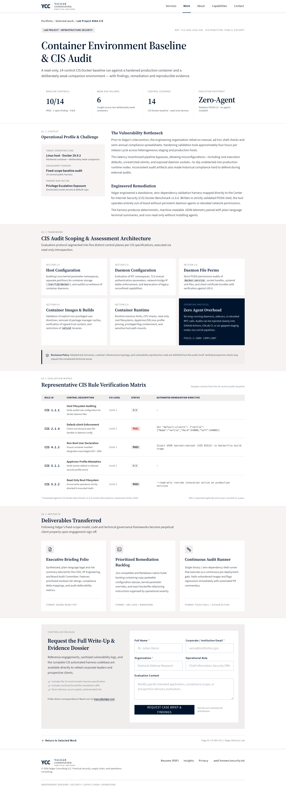

# Yalgar Consulting — Website & CIS Docker Audit Case Study

A production marketing site for **Yalgar Consulting LLC**, built with Next.js 14, plus an
evidence-backed CIS Docker audit case study, a governed dossier-delivery flow, and a
zero-dependency compliance harness.



## What's inside

| Area | What it is |
|---|---|
| Marketing site | Homepage, portfolio, privacy, responsive header/footer, editorial design system (Source Serif 4 + Source Sans 3) |
| Case study | `/work/container-environment-baseline` — the audit narrative, control matrix, artifacts and controlled-release form |
| Dossier | 8-page evidence PDF generated from measured audit JSON: [docs/dossier/container-environment-baseline.pdf](docs/dossier/container-environment-baseline.pdf) |
| CIS harness | `lab/cis-audit/audit.sh` — 14 read-only checks, JSON output, POSIX shell, no agents |
| Weak demo | `lab/cis-audit/demo-weak.sh` — deliberately weak containers that prove the checks discriminate |
| Tests | 11 automated tests (page, links, API validation, honeypot, rate limit, signed downloads, browser E2E) |
| Delivery flow | Dossier request API → optional CRM lead → signed 72-hour download link (dry-run by default) |

## Evidence at a glance

Measured on a Docker Cloud Sandbox (Linux 6.12, aarch64), Docker 29.9.3, Node 22.23.4:

| Check | Result |
|---|---|
| Hardened baseline (14 controls) | **10 PASS · 1 FAIL · 3 N/A** |
| Weak companion environment | **6 FAIL · 5 PASS · 3 N/A** — the same controls that pass on the hardened container catch real weaknesses |
| Application tests | 11/11 pass (browser E2E included locally) |
| Container smoke test | 4/4 routes HTTP 200; dossier API dry-run answered |
| Remaining baseline finding | `CIS 2.1.4` — default ulimits not declared at daemon level |

N/A means the lab kernel cannot evaluate the control (auditd not installed, AppArmor
unavailable). It is reported explicitly and never counted as a pass.

Full evidence: [`docs/evidence/`](docs/evidence/) — audit JSONs, run report, test log, HTTP log,
and the hashed bundle.

## The dossier

[**container-environment-baseline.pdf**](docs/dossier/container-environment-baseline.pdf) — 8 pages:
executive summary, method, baseline evidence, weak-environment evidence, findings F-01…F-07 with
remediation, reproducibility manifest, disclosure and limitations.


Regenerate it from the evidence:

```bash
npm run dossier:build
```

## Run the site

```bash
npm ci
npm run dev          # http://localhost:3000
npm run build        # production build
npm start            # production server
```

Tests (starts an isolated production server in dry-run mode):

```bash
npm test             # build + 11 tests
npm run test:only    # tests against an existing build
```

## Run the CIS audit

```bash
lab/cis-audit/audit.sh --json --out cis-baseline
```

Read-only: inspects daemon configuration, file permissions, auditd rules and running-container
flags. It installs nothing and changes nothing.

Weak demo (Linux + Docker only):

```bash
lab/cis-audit/demo-weak.sh --setup
lab/cis-audit/audit.sh --json --out cis-weak --no-fail-exit
lab/cis-audit/demo-weak.sh --cleanup
```

Reproduce the whole evidence pass (build → tests → image → container → audits → bundle):

```bash
bash scripts/run-homelab.sh
```

## Docker

```bash
docker build -t ycc-site .
docker run -d --name ycc-site -p 3000:3000 \
  --read-only --tmpfs /tmp --memory 512m --cpus 0.5 \
  --security-opt no-new-privileges \
  -e DOSSIER_DRY_RUN=1 -e DOSSIER_SEND_EMAIL=0 \
  -e SITE_URL=http://localhost:3000 \
  -v "$PWD/private:/app/private" ycc-site
```

The image is multi-stage, runs as a non-root user, and is ~183 MB.

## Dossier delivery flow

```
form (case-study page)
  → POST /api/dossier-request        validation · honeypot · rate limit
  → dossier registry (server-side)   correct PDF per research, never client-trusted
  → optional CRM lead + note         enabled only with environment credentials
  → signed 72-hour link (HMAC)       PDF lives outside public/, streamed only with a valid signature
  → download + audit log
```

The browser never receives credentials or file paths. The public repo defaults to **dry-run**:
no CRM writes, no email. Copy [`.env.example`](.env.example) to `.env` and provide your own values
to enable integrations.

## Repository layout

```
app/                 Next.js routes (home, work, case study, privacy, API)
components/          design system + case-study sections + dossier form
lib/                 copy, dossier registry, signing, request handling, integrations
lab/cis-audit/       audit harness + weak demo + fixtures
tests/               node:test suite (API + browser) and helpers
scripts/             run-homelab.sh, build-dossier.mjs
docs/                dossier PDF, previews, screenshots, evidence
public/              brand assets, security.txt
```

## License

Source is published for review and portfolio purposes. All rights reserved; no license is granted
for reuse or redistribution. Contact Yalgar Consulting for permissions.

Contact: inquiry@yalgar.com
